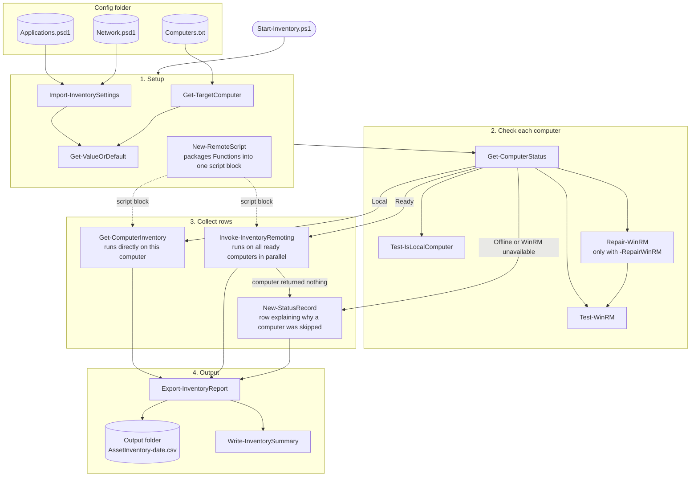
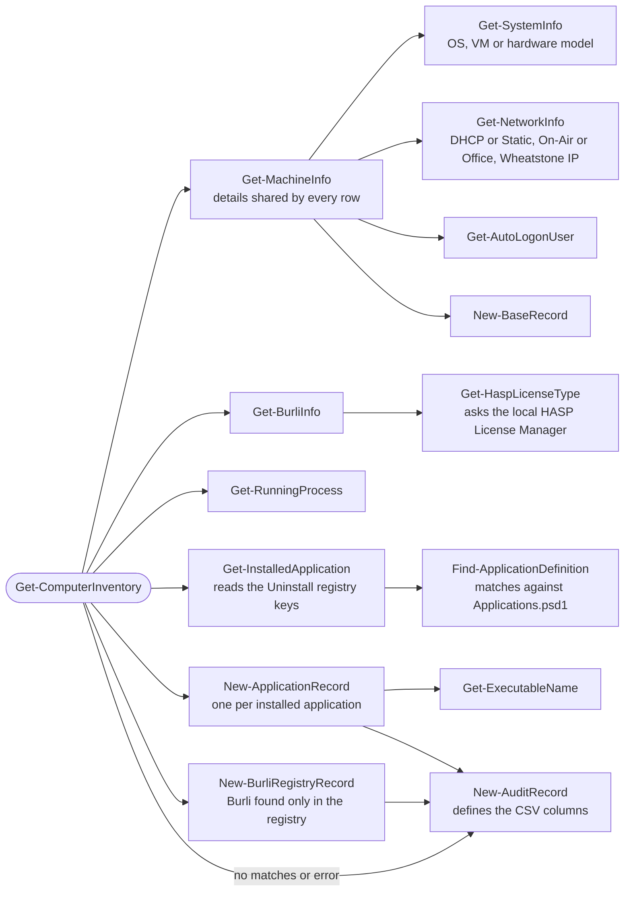

# PowerShell Asset Inventory


A PowerShell-based asset inventory and application auditing tool for Windows environments. The script remotely scans workstations and servers, discovers installed applications, gathers licensing and system information, and exports the results into a structured CSV report.

## Features

- Multi-system inventory collection using a configurable computer list.
- Automatic online/offline device detection.
- WinRM validation with optional remote remediation.
- Discovery of installed applications and broadcast-specific software including:
  - Burli
  - GV Stratus
  - OpenMedia
  - VoxPro
  - iMediaLogger
  - CSRDS
  - WideOrbit
  - Various encoder, automation, and support applications
- Hardware and virtualization detection (VMware, Hyper-V, and physical hardware).
- Network classification and IP discovery.
- Sentinel/HASP license discovery and reporting.
- Auto-logon account identification.
- Wheatstone network interface detection.
- Executable and application version discovery.
- CSV report generation for asset management and compliance tracking.

## Purpose

Many organizations have specialized software, licensing dongles, virtual machines, and operational systems that are difficult to inventory using traditional asset management tools. This script provides a repeatable and scalable method for collecting application, licensing, hardware, and user information across Windows environments.

## Output

The script generates a timestamped CSV containing the following information:

- Application Name
- Functionality
- End User / Server / Service Classification
- Service or Application Type
- Executable Name
- Software Version
- Licensing Information
- HASP ID
- Computer Name
- Operating System
- Primary User or Service Account
- Hardware Type
- Network Information
- Wheatstone Connectivity
- Engineering Notes

The resulting report provides a clean, one-row-per-application inventory that can be used for audits, software lifecycle planning, licensing reviews, infrastructure assessments, and migration projects.

## Getting Started

Requirements: Windows PowerShell 5.1 or later, WinRM enabled on target computers, and admin rights on the targets. PsExec is only needed for `-RepairWinRM`.

1. Copy `Config\Computers.example.txt` to `Config\Computers.txt` and list your hostnames, one per line.
2. Copy `Config\Network.example.psd1` to `Config\Network.psd1` and set your subnets.
3. Review `Config\Applications.psd1` and add or describe the applications you want to track.
4. Run the inventory:

```powershell
# Audit every computer in Config\Computers.txt
.\Start-Inventory.ps1

# Audit specific computers and show progress details
.\Start-Inventory.ps1 -ComputerName STUDIO-01, STUDIO-02 -Verbose

# Use alternate credentials and try to fix WinRM where it is not responding
.\Start-Inventory.ps1 -RepairWinRM -Credential (Get-Credential)

# Full parameter help
Get-Help .\Start-Inventory.ps1 -Full
```

Reports are saved to the `Output` folder as `AssetInventory-<date>_<time>.csv`. Every target appears in the report; computers that could not be audited get a row explaining why (Offline, WinRM unavailable, or the error message).

`Computers.txt`, `Network.psd1` and `Output\` are git-ignored, so hostnames, internal subnets and reports are never committed.

## Project Structure

```
Start-Inventory.ps1        Entry point: check each computer, collect rows, export
Config\
  Applications.psd1        Applications to track and how to describe them
  Network.example.psd1     Template for environment-specific subnets
  Computers.example.txt    Template for the computer list
Functions\                 One small function per file
```

`Start-Inventory.ps1` reads as three steps: work out the status of each computer (local, ready, offline or WinRM unavailable), collect the rows, then export. Each function does one job, and the code uses pipelines, lookup tables and early returns instead of nested if/else blocks.

Settings are PowerShell data files (`.psd1`) loaded with `Import-PowerShellDataFile`, which reads them as data and never executes them. The functions are packaged into a single script block and sent with `Invoke-Command`, so nothing needs to be installed on the target computers, and all reachable targets are audited in parallel.

## How It Works

### Overall flow

`Start-Inventory.ps1` loads the settings, checks each computer, collects the rows and exports the report. The status of each computer decides which path it takes.



### What runs on each computer

`Get-ComputerInventory` is the function sent to every target. It gathers the machine details once, then builds one row per tracked application. If nothing matches it returns a "No tracked applications found" row, and if anything fails it returns an error row, so every computer appears in the report.



### Function reference

| Stage | Function | What it does |
|---|---|---|
| Setup | `Import-InventorySettings` | Loads `Applications.psd1` and `Network.psd1` and fills in defaults |
| Setup | `Get-TargetComputer` | Returns computers from `-ComputerName`, `Computers.txt`, or this computer |
| Setup | `Get-ValueOrDefault` | Returns a value, or a fallback when it is empty |
| Setup | `New-RemoteScript` | Packages the Functions folder into one script block for remoting |
| Check | `Get-ComputerStatus` | Returns Local, Ready, Offline or WinRM unavailable |
| Check | `Test-IsLocalComputer` | Checks whether a name refers to this computer |
| Check | `Test-WinRM` | Checks whether a computer answers PowerShell remoting |
| Check | `Repair-WinRM` | Enables WinRM with PsExec (only with `-RepairWinRM`) |
| Collect | `Invoke-InventoryRemoting` | Runs the inventory on all ready computers in parallel |
| Collect | `New-StatusRecord` | Creates a row for a computer that could not be audited |
| On each computer | `Get-ComputerInventory` | Audits one computer and returns its rows |
| On each computer | `Get-MachineInfo` | Collects the details shared by every row |
| On each computer | `Get-SystemInfo` | Returns the OS and whether it is a VM or physical hardware |
| On each computer | `Get-NetworkInfo` | Returns DHCP or Static, On-Air or Office, and the Wheatstone IP |
| On each computer | `Get-AutoLogonUser` | Returns the auto-logon user from Winlogon |
| On each computer | `Get-BurliInfo` | Returns whether Burli is installed and its HASP ID |
| On each computer | `Get-HaspLicenseType` | Returns Dedicated or Network HASP |
| On each computer | `Get-RunningProcess` | Lists running processes and their paths |
| On each computer | `Get-InstalledApplication` | Finds installed programs that match a tracked application |
| On each computer | `Find-ApplicationDefinition` | Returns the first definition whose pattern matches a program name |
| On each computer | `New-ApplicationRecord` | Builds the row for one installed application |
| On each computer | `Get-ExecutableName` | Works out the application's main executable |
| On each computer | `New-BurliRegistryRecord` | Adds a Burli row when Burli is only in the registry |
| Rows | `New-BaseRecord` | Holds the machine details used in every row |
| Rows | `New-AuditRecord` | Creates one report row; its properties define the CSV columns |
| Output | `Export-InventoryReport` | Writes the rows to a timestamped CSV |
| Output | `Write-InventorySummary` | Prints totals and the report location |

## Why I Built It

I needed a reliable way to document application deployments, licensing dependencies, and workstation configurations across distributed Windows environments. Manual audits were time-consuming, difficult to maintain, and often inconsistent.

This project automates the discovery process and produces standardized reporting that can be used by engineering, operations, and IT teams to make informed decisions about infrastructure management, software licensing, and future technology upgrades.

## Technologies Used

- PowerShell
- WinRM
- PSExec
- WMI/CIM
- Windows Registry
- CSV Reporting
- Sentinel HASP Licensing
- Remote Systems Administration

## Example Use Cases

- Annual or quarterly asset audits
- IT asset inventory collection
- Software license validation
- Infrastructure modernization projects
- Workstation migration planning
- Disaster recovery inventories
- Compliance reviews

## Future Enhancements

- Active Directory integration
- Automated scheduling and reporting
- Database-backed inventory storage
- Web dashboard visualization
- Historical asset tracking
- Enhanced application fingerprinting
- Extended application support

---
